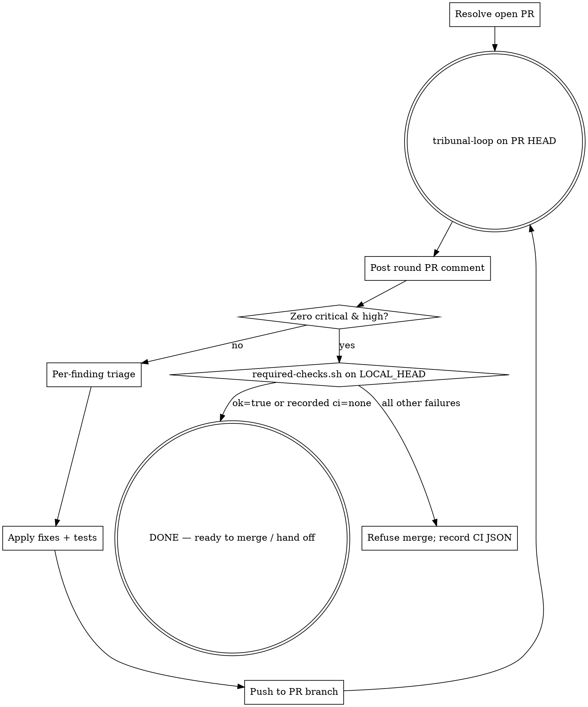

# Closing Tribunal Loop — Playbook & Common Mistakes

Reference guide for `closing-tribunal-loop` when checking applicability, PR/round shell setup, and failure modes.

## When to Use / Don't Use

**Use when:**
- Just ran `tribunal-loop` on a branch with an **open PR** and the verdict is `NEEDS_WORK` or `BLOCK`.
- Made a code change in response to a tribunal finding (any change → re-run required).
- About to mark the PR ready / merge / hand off, without re-running tribunal since the last commit.

**Don't use when:**
- There is no open PR for the current branch (open one first).
- Verdict is `APPROVE` with zero critical/high on the current diff **and** the closing round comment is already posted.
- Reading findings only (no code change planned) and not documenting a round.
- Documentation-only change or tribunal is not being run.

## Loop Diagram



## PR & Round Shell Helpers

```bash
git push
PR_JSON="$(gh pr view --json number,url,headRefOid,baseRefName,headRefName,state)"
PR_NUMBER="$(printf '%s' "$PR_JSON" | jq -r .number)"
PR_URL="$(printf '%s' "$PR_JSON" | jq -r .url)"
PR_HEAD="$(printf '%s' "$PR_JSON" | jq -r .headRefOid)"
LOCAL_HEAD="$(git rev-parse HEAD)"

PRIOR_MAX="$(gh api "repos/$(gh repo view --json nameWithOwner -q .nameWithOwner)/issues/${PR_NUMBER}/comments" \
  --paginate -q '.[].body' | grep -oE '<!-- tribunal-round:[0-9]+ -->' \
  | grep -oE '[0-9]+' | sort -n | tail -1)"
PRIOR_MAX="${PRIOR_MAX:-0}"
ROUND=$((PRIOR_MAX + 1))
```

## Common Mistakes

- **No open PR** — chat-only close-out is not this skill.
- **Reviewing unpushed HEAD** — local `HEAD` ≠ PR `headRefOid`; push and re-check first.
- **Resetting round count on resume** — always derive `ROUND` from existing markers.
- **Skipping the round PR comment** — no `<!-- tribunal-round:N -->` means no audit trail.
- **Fix-before-comment** — post the verdict/dispositions before applying fixes so a failed fix/push never leaves a verdict undocumented.
- **Stopping after round 1** — fixes create a new diff; re-run required.
- **Bundling out-of-scope fixes** — file a separate issue/PR.
- **One-line follow-up issues** — use `references/follow-up-issue.md`.
- **Stale verdict** — only the arbiter result on current HEAD counts, after its round comment is posted.
- **Merging without CI-proven green** — never skip `scripts/required-checks.sh` on `LOCAL_HEAD`; only the recorded `ci="none"` exception permits a non-zero exit.
